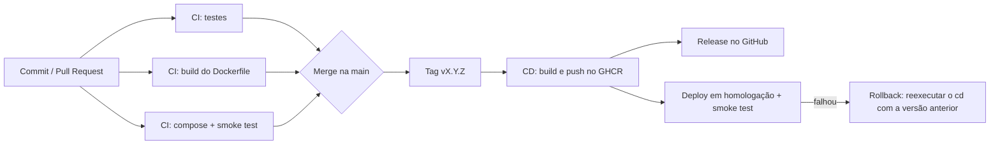

# Encurtador de URLs
[](https://github.com/LTbirdyy/devops/actions/workflows/ci.yml)


Projeto da disciplina de Integração DevOps — Ciência da Computação 2026_2.

Encurta URLs longas em códigos curtos, com cache em Redis para acelerar os
redirecionamentos mais acessados e persistência em PostgreSQL.

## Stack

- **Backend:** FastAPI (Python)
- **Banco de dados:** PostgreSQL (via SQLAlchemy)
- **Cache:** Redis
- **Front-end:** HTML/CSS/JS simples, servido pelo próprio FastAPI
- **Testes:** pytest
- **Contêineres:** Docker e Docker Compose
- **CI/CD:** GitHub Actions, com imagens publicadas no GitHub Container Registry (GHCR)

## Estratégia de ramificação e workflow do time

Usamos **Trunk-Based Development**:

- A branch `main` é a única branch de longa duração e representa sempre o
  estado estável do projeto.
- Toda alteração é feita em uma branch curta a partir da `main`, nomeada por
  tipo de tarefa: `feature/nome-da-tarefa`, `fix/nome-do-bug`,
  `docs/nome-do-ajuste` ou `feature/nome-do-responsavel`.
- A `main` é protegida: não é possível dar push direto nela. Toda mudança
  entra via **Pull Request**, que exige:
  - Aprovação de pelo menos 1 outro membro do grupo
  - O pipeline de CI (`build-and-test`) passando
- Versões são marcadas com **tags** (`v1.0.0`) criadas a partir da `main`;
  é a tag que dispara o pipeline de entrega (CD).
- Mensagens de commit seguem o padrão [Conventional Commits](https://www.conventionalcommits.org/)
  (`feat:`, `fix:`, `docs:`, `test:`, `chore:`).

### Papéis do grupo

| Membro           | Papel | Responsabilidades |
|------------------|---|---|
| Gabriel Fernando | Desenvolvedor | Backend: API, persistência, cache, testes automatizados |
| Alex Xiwang      | Qualidade | Front-end e validação do fluxo de uso ponta a ponta |
| Daniel Godoi     | Operações/Infraestrutura | Git, CI/CD, documentação técnica |

## Estrutura do projeto

```
devops/
├── app/
│   ├── main.py            # rotas da API e do front-end
│   ├── models.py          # tabela de URLs (SQLAlchemy)
│   ├── schemas.py         # validação de entrada/saída (Pydantic)
│   ├── shortener.py       # geração do código curto
│   ├── cache.py           # integração com Redis
│   ├── config.py          # configurações via variáveis de ambiente
│   └── static/index.html  # front-end
├── tests/                 # testes automatizados (pytest)
├── docs/
│   └── ROLLBACK.md        # versionamento e simulação de rollback
├── .github/workflows/
│   ├── ci.yml             # integração contínua
│   └── cd.yml             # entrega contínua (publicação + deploy)
├── Dockerfile             # imagem da aplicação
├── docker-compose.yml     # app + Postgres + Redis
├── .env.example           # modelo das variáveis de ambiente
└── requirements.txt
```

## Pré-requisitos

- Git instalado
- **Para rodar com Docker (recomendado):** Docker Desktop instalado e aberto
- **Para rodar sem Docker:** Python 3.11 ou superior ([python.org/downloads](https://www.python.org/downloads/))

## Como rodar

Primeiro, clone o repositório:

```bash
git clone https://github.com/LTbirdyy/devops.git
cd devops
```

### Opção 1: com Docker (Postgres e Redis de verdade)

É o mesmo ambiente usado no pipeline de CD, e não exige Python instalado.

**Windows (PowerShell):**
```powershell
copy .env.example .env
notepad .env          # troque POSTGRES_PASSWORD por uma senha sua
docker compose up --build
```

**Mac/Linux:**
```bash
cp .env.example .env
nano .env             # troque POSTGRES_PASSWORD por uma senha sua
docker compose up --build
```

> Use apenas letras e números na senha: caracteres como `@`, `/`, `:` e `#`
> quebram a URL de conexão do banco.

Acesse **http://localhost:8000**. Com isso a aplicação usa Postgres e Redis
reais, então **não é necessário** definir `TESTING=true`.

Para conferir: `docker compose ps` deve mostrar `app`, `db` e `redis` como
`healthy`, e `http://localhost:8000/health` deve responder `{"status":"ok"}`.

Para parar: `Ctrl+C` e depois `docker compose down`. Use `docker compose down -v`
para apagar também os dados do banco (necessário se você trocar a senha no
`.env` depois do banco já ter sido criado).

### Opção 2: sem Docker (modo de desenvolvimento)

Nesse modo a aplicação usa um arquivo SQLite local no lugar do Postgres e um
Redis "falso" em memória (`fakeredis`, o mesmo dos testes). Serve para
desenvolver e testar rápido, sem nenhum serviço externo.

**1. Crie e ative o ambiente virtual**

*Windows (PowerShell):*
```powershell
python -m venv venv
venv\Scripts\Activate.ps1
```
> Se aparecer um erro dizendo que a execução de scripts está desabilitada, rode uma vez:
> `Set-ExecutionPolicy -Scope CurrentUser -ExecutionPolicy RemoteSigned`, depois tente ativar de novo.

*Mac/Linux:*
```bash
python3 -m venv venv
source venv/bin/activate
```

Se estiver usando o PyCharm, ele pode já ter criado e ativado uma pasta
`.venv` automaticamente. Nesse caso não é necessário criar outra.

**2. Instale as dependências**

```bash
pip install -r requirements.txt
```

**3. Rode a aplicação**

*Windows (PowerShell):*
```powershell
$env:TESTING='true'
uvicorn app.main:app --reload
```

*Mac/Linux:*
```bash
TESTING=true uvicorn app.main:app --reload
```

Acesse **http://localhost:8000**.

> **Por que `TESTING=true`?** Sem ele a aplicação tenta conectar num Redis de
> verdade em `localhost:6379` e, se ele não existir, quebra com
> `redis.exceptions.ConnectionError`. A variável só vale para o terminal em que
> foi definida: se você abrir uma janela nova, defina de novo.

## Como rodar os testes automatizados

**Windows (PowerShell):**
```powershell
$env:TESTING='true'; python -m pytest -v
```

**Mac/Linux:**
```bash
TESTING=true python -m pytest -v
```
(Usar `python -m pytest` em vez de só `pytest` evita erros de importação do
módulo `app` em algumas configurações.)

Os testes usam SQLite e um Redis falso (`fakeredis`) internamente, então
rodam rápido e não exigem nenhum serviço externo rodando.

## Endpoints da API

| Método | Rota            | Descrição                                                |
|--------|-----------------|-----------------------------------------------------------|
| GET    | `/`             | Página do front-end                                        |
| POST   | `/shorten`      | Recebe `{"url": "https://..."}` e retorna o código curto  |
| GET    | `/{short_code}` | Redireciona para a URL original                            |
| GET    | `/health`       | Healthcheck (usado pelo Docker, pelo CI e pelo CD)         |

## Pipeline de CI/CD



| Workflow | Quando roda | O que faz |
|---|---|---|
| `ci.yml` → `test` | Push e PR na `main` | Instala dependências e roda os testes (`pytest`) |
| `ci.yml` → `docker-build` | Push e PR na `main` | Valida que o Dockerfile gera a imagem (sem publicar) |
| `ci.yml` → `compose-smoke-test` | Push e PR na `main` | Sobe app + Postgres + Redis com `docker compose`, encurta um link e confere o redirecionamento |
| `cd.yml` → `build-and-push` | Ao criar uma tag `vX.Y.Z` | Builda a imagem, publica no GHCR com tags semânticas e cria a Release |
| `cd.yml` → `deploy-homologacao` | Após o build, ou manualmente (rollback) | Baixa a imagem versionada do registry, sobe o ambiente simulado e roda o smoke test |

O ambiente de homologação é **simulado**: roda na máquina temporária do GitHub
Actions, não em um servidor persistente.

## Gestão de configurações e segredos

Nenhuma senha está salva no código-fonte.

| Item | Onde fica | Quem usa |
|---|---|---|
| `GITHUB_TOKEN` | Secret automático, gerado pelo GitHub a cada execução | `cd.yml` (login no GHCR e criação da Release) |
| `POSTGRES_PASSWORD` | Secret do Environment `homologacao` (*Settings → Environments*) | `cd.yml` (deploy em homologação) |
| Senha do teste do compose | Gerada aleatoriamente a cada execução do job | `ci.yml` (`compose-smoke-test`) |
| `.env` | Arquivo local de cada pessoa, ignorado pelo Git | `docker compose` na máquina local |
| `.env.example` | Modelo versionado, só com valores de exemplo | Referência para criar o `.env` |

O `docker-compose.yml` exige `POSTGRES_PASSWORD` (`${POSTGRES_PASSWORD:?...}`):
se a variável não existir, o compose se recusa a subir, em vez de usar uma
senha padrão.

## Versionamento e rollback

Usamos versionamento semântico (`MAJOR.MINOR.PATCH`). Cada versão é uma tag
Git, e o `cd.yml` publica as tags de imagem `1.0.0`, `1.0` e `latest` no GHCR.

Para lançar uma versão (com a `main` atualizada e o CI verde):

```bash
git checkout main
git pull
git tag v1.0.0
git push origin v1.0.0
```

Para fazer **rollback**: *Actions → cd → Run workflow* e informar a última
versão estável (ex.: `1.0.0`). O fluxo completo, com as evidências da
simulação, está em [docs/ROLLBACK.md](docs/ROLLBACK.md).

## Problemas comuns

| Sintoma | Causa provável | Solução |
|---|---|---|
| `'python' não foi encontrado` | Python não instalado ou não está no PATH | Reinstale o Python marcando "Add Python to PATH", e desative os aliases da Microsoft Store em Configurações → Aplicativos → Aliases de execução de aplicativo |
| `ModuleNotFoundError: No module named 'fastapi'` (ou outro pacote) | Ambiente virtual não ativado, ou dependências não instaladas nele | Confirme que `(venv)` ou `(.venv)` aparece no prompt, depois rode `pip install -r requirements.txt` de novo |
| Erro ao instalar `psycopg2-binary` (`pg_config not found`) | A versão do pacote não tem wheel pronto para a sua versão do Python | Use uma versão mais recente do pacote (`psycopg2-binary==2.9.10` ou superior) |
| `ModuleNotFoundError: No module named 'app'` ao rodar `pytest` | O pytest não está enxergando a pasta raiz do projeto | Rode `python -m pytest -v` em vez de apenas `pytest -v` |
| `PermissionError` ao final dos testes no Windows (arquivo `test_ci.db` em uso) | O Windows trava o arquivo SQLite até a conexão ser fechada | Já corrigido no `tests/conftest.py` com `engine.dispose()` antes de apagar o arquivo |
| `redis.exceptions.ConnectionError` ao rodar o `uvicorn` | Não há Redis rodando em `localhost:6379` | Use `TESTING=true` (Opção 2) ou rode com Docker (Opção 1) |
| `docker` não é reconhecido, ou `cannot connect to the Docker daemon` | Docker Desktop não instalado ou fechado | Abra o Docker Desktop, espere o "Engine running" e abra um terminal novo |
| `defina POSTGRES_PASSWORD no .env` | O arquivo `.env` não existe ou está em outra pasta | Rode `copy .env.example .env` na mesma pasta do `docker-compose.yml` |
| `port is already allocated` (porta 8000) | Outro processo, como um `uvicorn` antigo, usa a porta | Pare o processo antigo com `Ctrl+C` |
| `password authentication failed` | A senha do `.env` foi trocada depois do banco já ter sido criado | `docker compose down -v` e depois `docker compose up --build` |

## Roadmap do projeto (A1 → A3)

- [x] A1: Repositório estruturado, código com testes automatizados, pipeline de CI
- [x] A2: Dockerfile, docker-compose, pipeline de CD, gestão de segredos, versionamento/rollback
- [ ] A3 (09/12/2026): Pipeline DevSecOps (SAST + scan de vulnerabilidades), observabilidade (Grafana), documentação técnica completa, live demo
