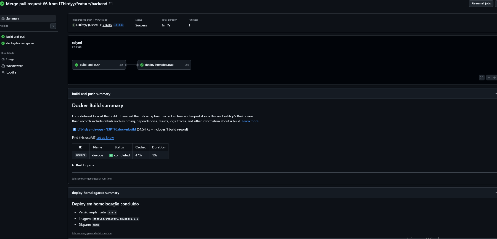
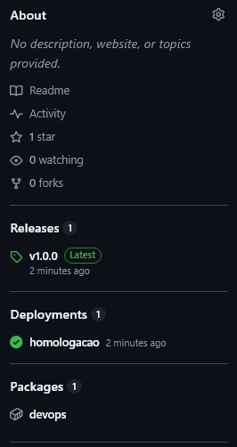
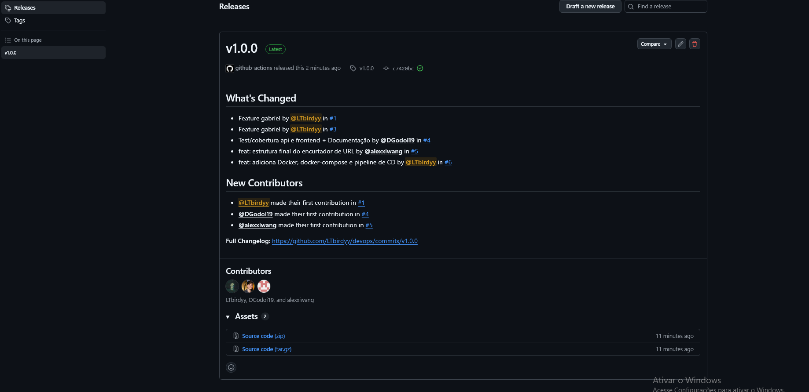
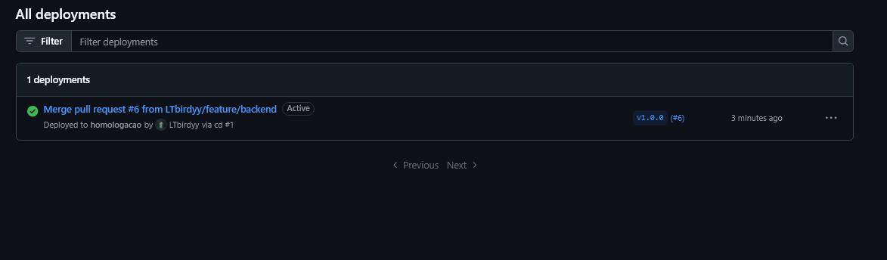
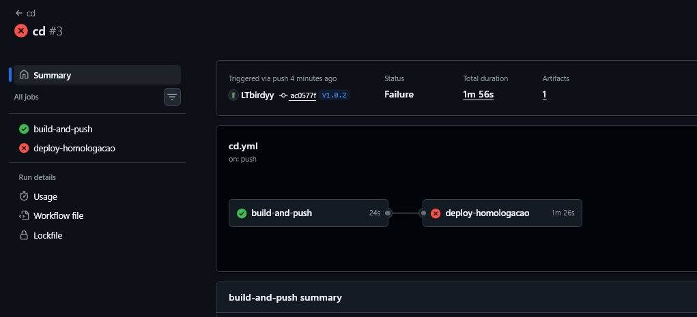
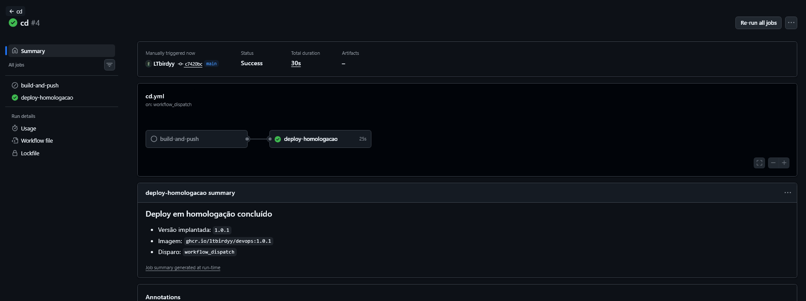
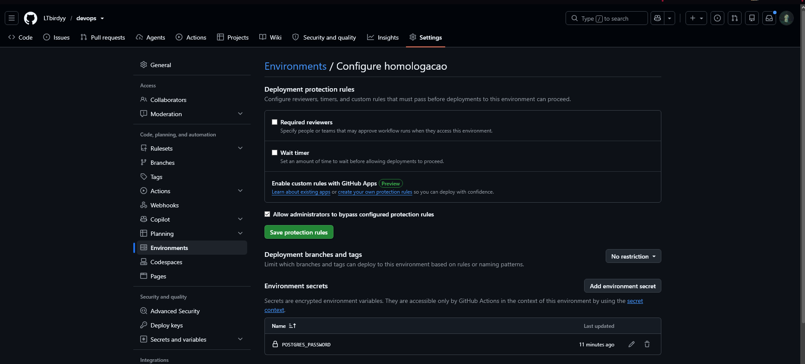

# Versionamento semântico e rollback

## Versionamento

Usamos [versionamento semântico](https://semver.org/lang/pt-BR/) (`MAJOR.MINOR.PATCH`):

| Mudança | Exemplo | Quando usar |
|---|---|---|
| PATCH | `1.0.0` → `1.0.1` | Correção de bug sem mudar o comportamento |
| MINOR | `1.0.1` → `1.1.0` | Funcionalidade nova compatível |
| MAJOR | `1.1.0` → `2.0.0` | Mudança que quebra compatibilidade |

Cada versão é uma **tag Git** (`v1.0.0`). Ao criar a tag, o pipeline `cd.yml`
publica no GitHub Container Registry as tags de imagem `1.0.0`, `1.0` e
`latest`, e cria uma Release no GitHub com as notas geradas automaticamente.

Um número de versão nunca é reutilizado: se uma versão sair com defeito, a
correção vira a versão seguinte.

### Como lançar uma versão

Depois que o Pull Request foi aprovado e mergeado, com a `main` atualizada e o
CI verde:

```bash
git checkout main
git pull
git tag v1.0.0
git push origin v1.0.0
```

Acompanhe em **Actions → cd**: build, push da imagem, deploy em homologação e
smoke test.

## Fluxo de rollback

Cenário: uma versão foi publicada, mas apresenta falha em homologação.

1. O job `deploy-homologacao` falha no smoke test (a aplicação não responde ao
   `/health`) e imprime os logs dos containers.
2. Em **Actions → cd → Run workflow**, informe a última versão estável no campo
   `version`.
3. O pipeline pula o build (a imagem estável já existe no registry), faz o pull
   dela, sobe o ambiente e roda o mesmo smoke test.
4. Com o smoke test verde, o ambiente está de volta à versão estável.
5. Corrija o problema em uma branch, abra o PR e lance uma nova versão.

> Por que funciona: as imagens são imutáveis e versionadas. Voltar de versão é
> só apontar o `APP_IMAGE` do compose para uma tag anterior.
>
> Observação: depois de publicar uma versão defeituosa, a tag de imagem `latest`
> passa a apontar para ela. Isso não afeta o rollback, porque o deploy sempre
> usa uma versão explícita, nunca `latest`.

## Simulação realizada

| Versão | Situação | Resultado do deploy em homologação |
|---|---|---|
| `1.0.0` | Estável | Verde |
| `1.0.1` | Estável (versão de destino do rollback) | Verde |
| `1.0.2` | Defeito proposital no `/health` | **Vermelho** |
| Rollback para `1.0.1` | Execução manual do workflow `cd` | Verde |

### Como a falha foi provocada

A falha foi criada **fora da `main`**. Mergear um `/health` quebrado seria
bloqueado pelo teste `test_health_check` e pela proteção de branch, o que é o
comportamento correto. Como o `cd.yml` dispara por tag, foi possível versionar
o commit com defeito sem mergeá-lo:

```bash
git checkout -b test/falha-proposital
# em app/main.py, o health_check passou a fazer:
#   raise HTTPException(status_code=500, detail="falha proposital para simular rollback")
git add app/main.py
git commit -m "test: injeta falha proposital no /health para simular rollback"
git tag v1.0.2
git show v1.0.2:app/main.py   # conferir que a tag contém o defeito
git push origin v1.0.2
```

Esse commit nunca foi enviado para a `main`. Resultado: o build publicou a
imagem `1.0.2`, mas o `deploy-homologacao` falhou no passo "Aguardar a
aplicação ficar saudável".

### Como o rollback foi executado

**Actions → cd → Run workflow** (branch `main`), campo `version` = `1.0.1`. O
build foi pulado, o deploy da `1.0.1` ficou verde e o resumo da execução
registrou a versão implantada e o disparo `workflow_dispatch`.

Depois, o ambiente local voltou ao normal:

```bash
git checkout main
git branch -D test/falha-proposital
```

A tag e a Release `v1.0.2` permanecem como evidência da falha.

## Evidências

### 1. Release `v1.0.0` publicada (`cd` verde)



### 2. Imagens no GitHub Container Registry



### 3. Release `v1.0.0` na página de Releases



### 4. Ambiente `homologacao` em Deployments



### 5. Versão `1.0.2` com falha (deploy vermelho)



### 6. Rollback para `1.0.1` (deploy verde)



### 7. Secret configurado no Environment (valor oculto)



## Registro do incidente simulado

| Campo | Preenchimento |
|---|---|
| Versão com defeito | `1.0.2` |
| Como foi detectado | Smoke test do deploy (a aplicação não respondeu ao `/health`) |
| Impacto | Homologação indisponível com a `1.0.2`; nenhum usuário real afetado |
| Ação tomada | Rollback para a `1.0.1` via workflow `cd` (`workflow_dispatch`) |
| Causa raiz | Falha injetada de propósito no endpoint `/health` |
| Ação preventiva | Smoke test obrigatório no deploy; versões nunca reutilizadas; deploy sempre por versão explícita (nunca `latest`) |
